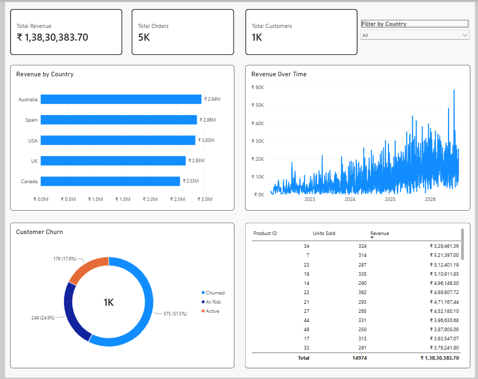
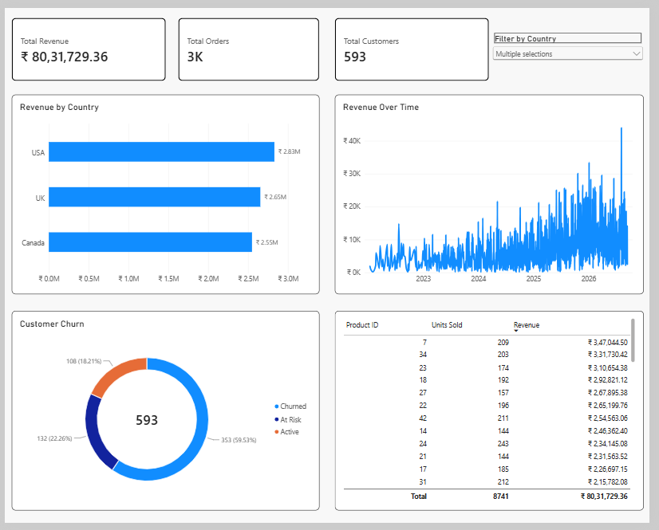
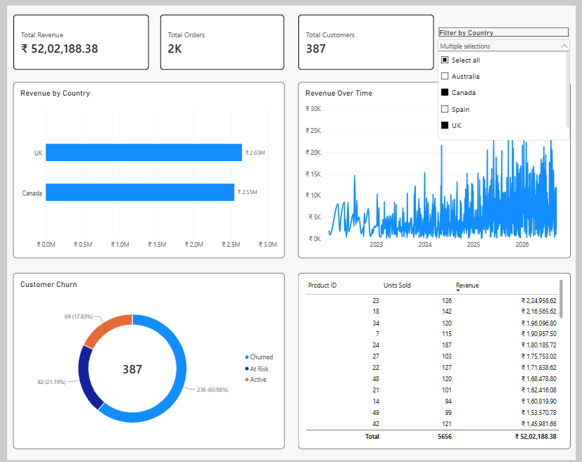
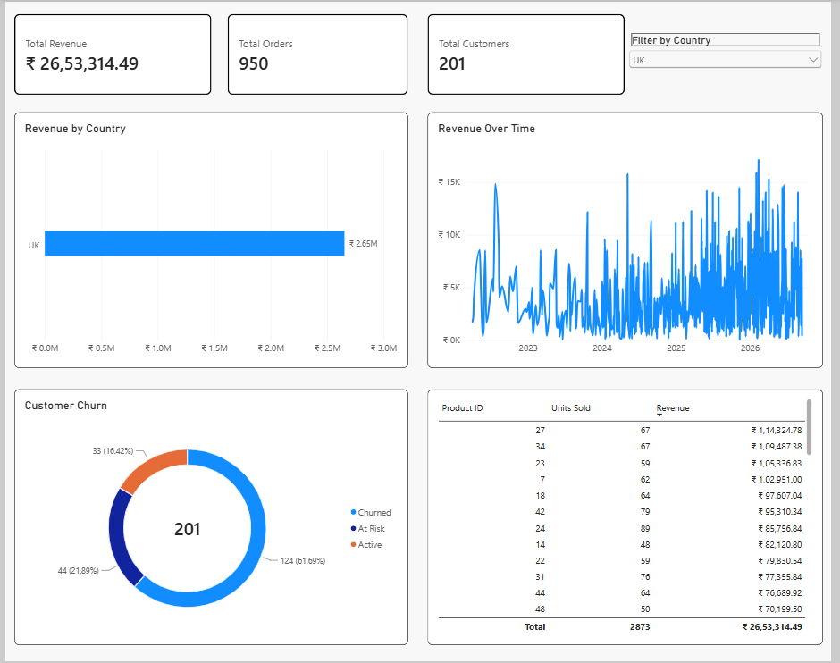

# Global E-Commerce Data Analytics & Pipeline Architecture 🛒

## Project Overview
An end-to-end data engineering and business intelligence project demonstrating synthetic data generation, relational database modeling, and interactive data visualization. This project generates a realistic e-commerce dataset using Python, structures and queries the data in MySQL using advanced SQL techniques, and visualizes customer churn and global revenue performance in Power BI.

## Tech Stack
*   **Data Generation & Processing:** Python, Pandas, NumPy, Faker, SQLAlchemy
*   **Database:** MySQL (Relational Schema, Indexing, Views)
*   **Business Intelligence:** Power BI (Interactive Dashboards, DAX)

## Executive Summary & Key Insights
*   **Global Performance:** The main dashboard tracks **₹1,38,30,383.70** in total revenue across **5,000 orders** from **1,000 customers**.
*   **Regional Market Share:** Australia, Spain, and the USA lead revenue generation, followed closely by the UK and Canada.
*   **Customer Retention:** Advanced churn tracking segments the customer base into 'Active' (57.5%), 'At Risk' (24.9%), and 'Churned' (17.6%).

## Dashboard Previews

### Global Executive View
*Worldwide KPIs, revenue by country, time-series revenue, and customer churn.*

### Regional Market Analysis (UK, USA, Canada)
*Interactive filtering and regional KPI adjustments.*

### Regional Market Analysis (UK & Canada)

### Regional Market Analysis (UK Only)

## Data Architecture & Pipeline

1.  **Synthetic Data Generation (`generate_ecommerce_data.py`)**
    *   Utilizes the `Faker` library and `numpy` to generate realistic customer profiles across 5 countries (USA, UK, Spain, Canada, Australia).
    *   Builds a product catalog of 50 tech items and loads 5,000 logically consistent orders directly into MySQL via `sqlalchemy`.

2.  **Database Modeling & Advanced SQL (`ecommerce_analysis.sql`)**
    *   **Schema Design:** Creates normalized `Customers`, `Products`, and `Orders` tables with foreign key constraints and indexing for query performance.
    *   **Customer Segmentation:** Uses CTEs and `DENSE_RANK()` window functions to identify the Top 5% of customers by lifetime spend.
    *   **MoM Growth & Churn:** Implements the `LAG()` window function to calculate Month-over-Month revenue growth and utilizes `DATEDIFF` logic to classify customer churn risk.
